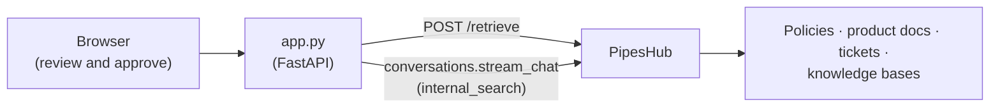

# Answer Security Questionnaires and RFPs with PipesHub

**A workbench that drafts every answer from your company's own documents, shows its sources, and exports only the answers a person approved.**

**The problem:** every deal brings another security questionnaire or RFP, and most of its questions were answered last quarter. The approved answers are spread across policies, architecture docs, product docs, tickets and old questionnaires, so someone copies and pastes from a stale spreadsheet and nobody can say where an answer came from. An AI that answers from memory makes it worse: it will happily claim a certification you don't hold.

This example drafts each answer from PipesHub, which searches only what the token's owner may see, and keeps the sources next to the draft. Any answer without a source is marked **needs review**, and nothing goes into the export until a person approves it.

## What you'll build

A web page where you paste or open a questionnaire (a CSV with a `question` column, or one question per line). For each question it shows:

- **A draft answer** from PipesHub's internal search, which you can edit.
- **The sources it cites**, each linking to the record in PipesHub.
- **What PipesHub found** for the question, so a reviewer can check the search separately from the answer.
- **A status**: *needs review* (no source, or the draft says the evidence is missing), *draft · one source*, or *draft · several sources*. You approve or reject each answer.

**Export approved (CSV)** writes only the approved answers, with their sources.

## What it looks like

This is a run of the bundled [sample questionnaire](sample-questionnaire.csv) against a PipesHub that holds PipesHub's own documentation (see [Try it on PipesHub's own documentation](#try-it-on-pipeshubs-own-documentation)):

```
Security questionnaire workbench
─────────────────────────────────────────────────────────────────────────────
12 questions · 0 approved · 3 need review · 0 drafting   [Export approved (CSV)]

SEC-01  Does the platform support single sign-on with SAML           Draft · several sources
        or OpenID Connect?
        Yes. The platform supports single sign-on through both SAML and
        OpenID Connect/OAuth 2.0 identity providers. SAML can be configured
        with providers such as Okta, Azure AD, OneLogin, Google Workspace…
        auth-saml    · PipesHub documentation
        auth-oauth   · PipesHub documentation
        [Approve] [Reject] [Draft again]

SEC-04  How do we report a security vulnerability to you?            Draft · one source
        Report security vulnerabilities by emailing security@pipeshub.com;
        do not submit them through public GitHub issues…
        pipeshub-repo-SECURITY · PipesHub documentation

CERT-01 Do you hold a current SOC 2 Type II report?                  Needs review
        NEEDS REVIEW — The connected knowledge references SOC 2 generally,
        but does not confirm that PipesHub holds a current SOC 2 Type II
        report. Evidence needed: …
```

## Architecture



The app is one file. For each question it makes two calls: `POST /api/v1/retrieve` for the evidence list (unlike search, it saves no search history, so a 200-question run doesn't fill yours), and the SDK's `conversations.stream_chat` in `internal_search` mode for the cited draft. The retrieve call is read directly because `pipeshub-sdk` 2.0.0 rejects its response when a record has no page numbers; the SDK's `semantic_search.retrieve` is the same call once that is fixed. The review state and the export live in the browser. Nothing is stored on the server.

## Prerequisites

- A running PipesHub with an LLM configured and your source material in it: a connected source, or documents uploaded to a knowledge base. The [quickstart](https://github.com/pipeshub-ai/pipeshub-ai#-quickstart-recommended) gives you a local instance.
- A **Personal Access Token** from **Workspace → Developer settings → Personal Access Tokens → New token**, with the `semantic:write` and `conversation:chat` scopes.
- Python 3.10+ with [`uv`](https://docs.astral.sh/uv/).

## Run it

```bash
export PIPESHUB_URL=http://localhost:3000
export PIPESHUB_BEARER_AUTH=phpat_eyJhbGciOi...

cd python
uv run app.py            # installs pipeshub-sdk, fastapi, uvicorn on first run
                         # PORT=8090 uv run app.py if 8080 is taken
```

Open **http://localhost:8080**, click **Load the sample questionnaire** (or open your own CSV) and then **Draft answers**. Each answer takes from a few seconds to about a minute, because PipesHub's agent may search more than once before it answers. The page drafts three questions at a time, and a question that fails shows an error without stopping the others.

Source links point at your PipesHub. If reviewers reach PipesHub at a different address from the app, set `PIPESHUB_PUBLIC_URL` to that address.

## Try it on PipesHub's own documentation

To see it work before you connect your own sources, answer the sample questionnaire about PipesHub itself. [`upload_docs.py`](python/upload_docs.py) uploads a folder of Markdown to a knowledge base:

```bash
git clone --depth 1 https://github.com/pipeshub-ai/documentation
uv run python/upload_docs.py documentation      # creates the "PipesHub documentation" knowledge base
```

Wait a few minutes for indexing, then run the sample. Questions the docs answer (SSO, permissions, self-hosting, model choice, connectors, MCP) come back with sources. The SLA, SOC 2 and training-data questions come back **needs review**, because the docs don't answer them.

## Why naive RAG isn't enough

The obvious build is to embed last year's answers and your policies in a vector store and have a model fill in the questionnaire. That fails here in four ways:

1. **Permissions.** Questionnaire evidence includes internal architecture, audit reports and contracts. A shared index shows all of it to anyone who uses the tool. PipesHub answers as the token's owner and never returns a record that person can't open.
2. **Freshness.** A copied answer library goes stale the day a policy changes. PipesHub searches the live sources, and every citation names the record it came from.
3. **Provenance.** A reviewer can't approve "we encrypt data at rest" without seeing where it says so. Every draft here carries its sources, and the evidence list shows what the search found even when the answer didn't use it.
4. **No invented claims.** A similarity score is not proof. Here the rule is simple and visible: no source means *needs review*, and nothing is exported without a person's approval.

## Customize it

- **Answer as each reviewer.** This example uses one Personal Access Token. For a team, have people sign in so every search runs with their own access: see [Sign in with PipesHub](../sign-in-with-pipeshub/).
- **Limit the sources.** Add `"filters": {"kb": [...]}` (or `{"apps": [...]}`) to the retrieve request and pass the same `filters=` to `stream_chat`, for example to answer only from approved policy documents.
- **Route by topic.** Send legal, SLA, pricing and certification questions to a named approver, however many sources they have.
- **Keep history.** Store each approved answer with its sources and the date, so the next questionnaire can reuse it after checking that the sources haven't changed.

## Next steps

- Search the same knowledge from your coding assistant: [Company Knowledge MCP](../company-knowledge-mcp/).
- Upload files that live in no connected tool: [Knowledge Base Upload](../knowledge-base-upload/).
- Built something on PipesHub? Open a [showcase issue](https://github.com/pipeshub-ai/examples/issues/new?template=showcase.yml).
